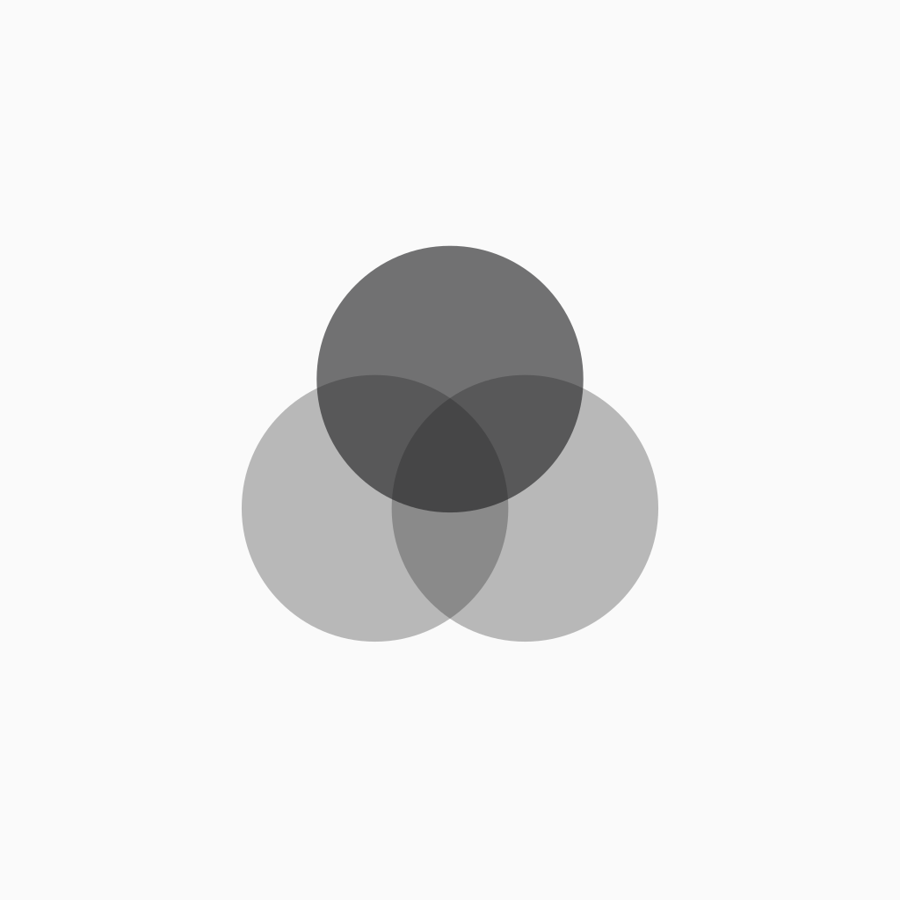
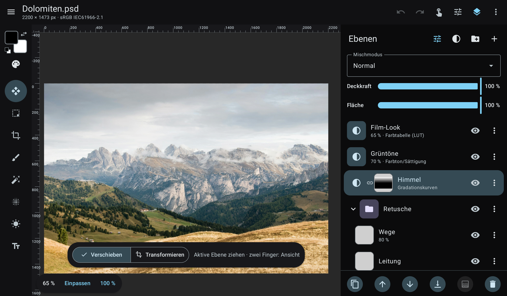
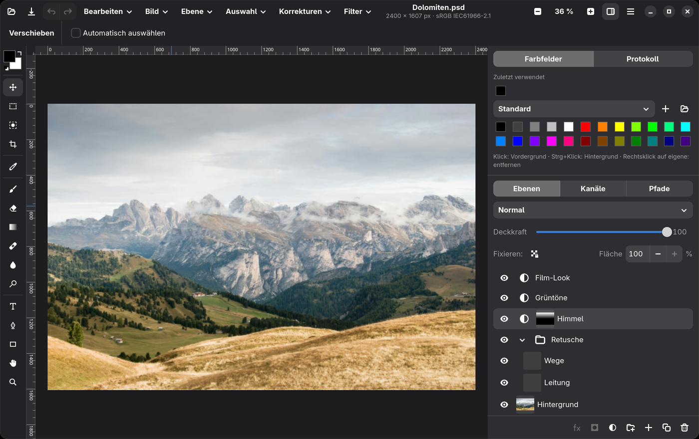
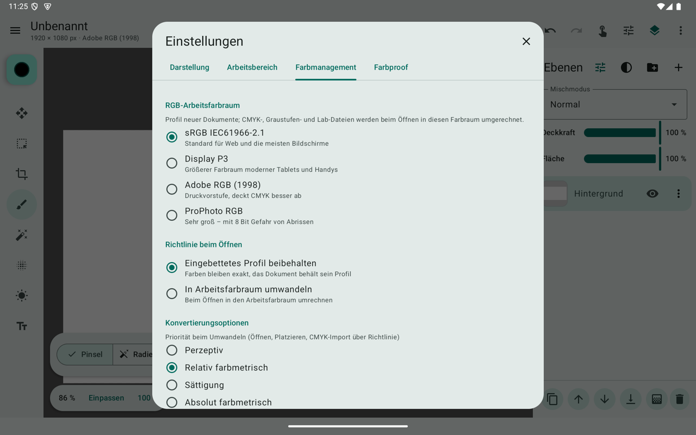
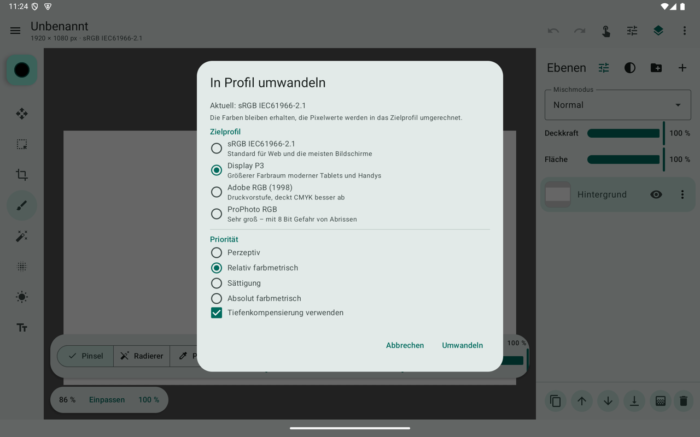
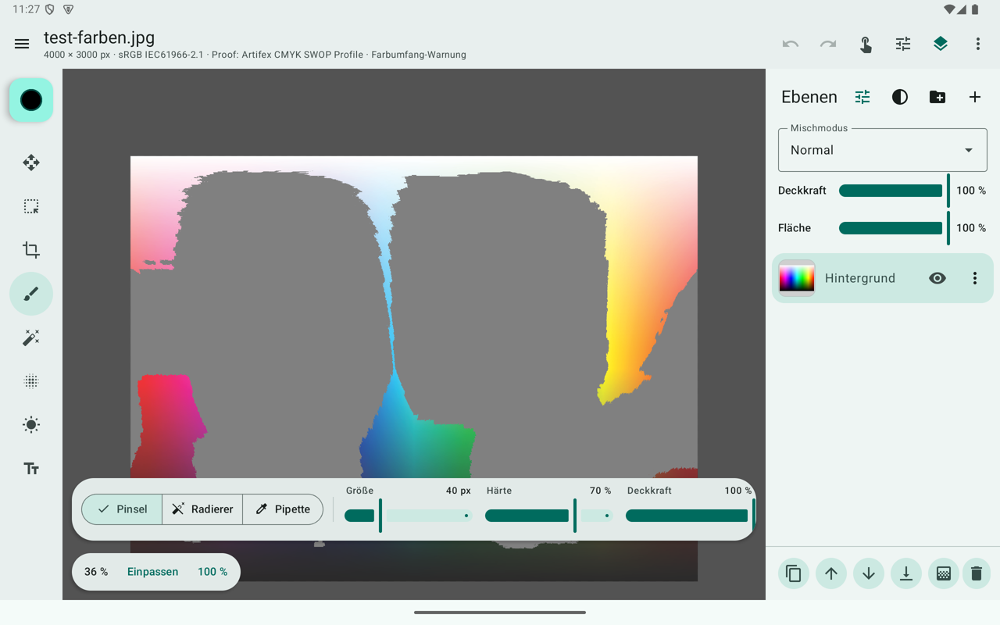
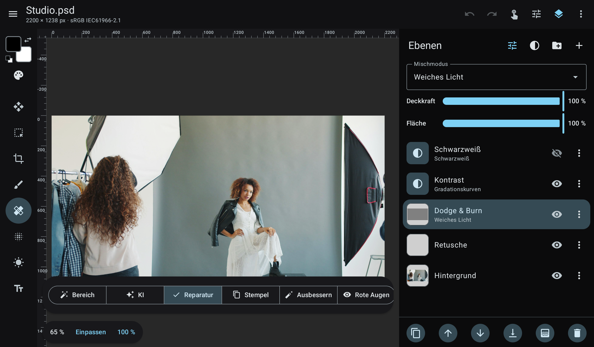
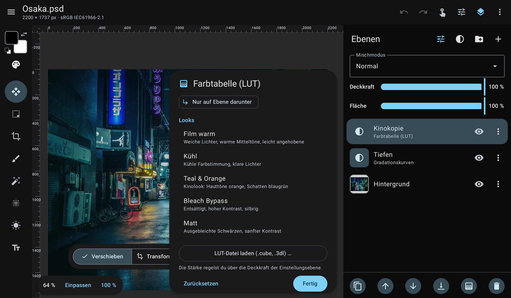

<p align="center"></p>

<h1 align="center">photographics</h1>

<p align="center"><b>A layer-based photo editor for Android tablets and Linux.</b><br>
Layers, masks and retouching with the pen. Opens and saves PSD, TIFF and GIMP files with all their layers.</p>

<p align="center"><a href="https://photographics.andreasbartelmess.de/en/">Website</a> · <a href="README.de.md">Deutsch</a> · <a href="../../releases">Download</a> · <a href="CONTRIBUTING.md">Contributing</a></p>

> **This is an early preview (version 0.4).** Most of it works, some things are missing or still change.
> Please keep a backup of important files. Feedback, bug reports and people who want to help build it
> are very welcome: open an [issue](../../issues/new/choose) or write to info@andreasbartelmess.de.



Retouch on a tablet with a pen, then continue on the desktop with the same file – since 0.4 also in
photographics itself: the **Linux version** (GNOME, Flatpak) shares the same core.



 The user interface is
available in **English and German**; more translations are one of the easiest ways to help.

## Features

- **PSD/PSB** read and write: layers, groups, all 27 blend modes (incl. pass through), pixel masks,
  clipping masks, adjustment layers (editable, in Photoshop's own format), text layers, smart objects,
  8/16/32-bit and RGB/Grayscale/CMYK/Lab/Duotone/Indexed/Bitmap files. Layer effects (drop and inner
  shadow, outer and inner glow, stroke, colour overlay) are rendered; unknown data is written back unchanged.
- **TIFF** read and write, **including Photoshop layers** (in both Macintosh and IBM PC byte order):
  LZW/ZIP/PackBits, strips and tiles, 1–32 bit, RGB/grey/palette/CMYK/Lab, transparency, ICC profiles.
  Saved TIFFs open in Photoshop with all layers.
- **GIMP (XCF)** read and write: layers with offsets, groups, masks, blend modes, guides, resolution and
  ICC profile; 8/16/32-bit integer and half/float/double, linear or perceptual (verified layer by layer
  against GIMP 3). Saved XCFs use perceptual blending, so GIMP shows them exactly like photographics.
- **Retouching:** spot healing (PatchMatch), healing brush and patch (Poisson blending), clone stamp,
  red eye, dodge/burn/sponge, smudge, liquify, content-aware fill (texture-aware PatchMatch with seamless
  colour matching at the edge) and optional **on-device AI** object removal (MI-GAN, LaMa) and upscaling
  (Real-ESRGAN). Nothing leaves the device.
- **Selections and gradients:** rectangle, ellipse, lasso, **magic wand** and **object selection**
  (drag a box around the subject); gradient tool (linear, radial, reflected) on layers or masks;
  **auto-select** for the move tool picks the layer under your finger.
- **Pen first:** pressure, eraser end, side button = eyedropper, palm rejection, hover preview,
  two-finger undo; keyboard and mouse with Photoshop-style shortcuts.
- **Brush engine (F5):** tip angle/roundness, shape dynamics, scattering, transfer (opacity/flow by
  pressure, fade, jitter), colour dynamics, all blend modes plus Behind/Clear, airbrush; 12 built-in
  presets and your own. Foreground/background colour (X, D) and swatch libraries with import/export
  of Photoshop `.aco`/`.act`, Adobe Swatch Exchange `.ase` and GIMP `.gpl`.
- **Layers like in Photoshop:** masks linked or unlinked from their layer (chain icon), clipping masks
  (Ctrl+Alt+G, adjustment layers "affect only the layer below").
- **Non-destructive editing:** 13 adjustment layer types (curves per channel with histogram, levels,
  hue/saturation, colour lookup, …), free transform via smart objects, 24 filters with live preview.
- **Colour management:** ICC engine (v2/v4, matrix/TRC and LUT profiles, all rendering intents, black
  point compensation – verified against Little CMS), document profiles, assign/convert to profile,
  CMYK/Lab PSDs converted through their embedded profile, soft proof with your print shop's ICC profile
  and gamut warning, export with embedded profile or converted to sRGB.
- **LUTs:** `.cube`/`.3dl` colour lookup layers (saved as Photoshop *Color Lookup* layers),
  10 built-in looks, export of your adjustments as a `.cube` LUT.
- **Large files:** pixel data lives in native shared memory outside the Java heap, the undo history
  is swapped to a scratch disk like in Photoshop, and all heavy operations work in bands on all CPU
  cores. Moving, transforming and changing opacity preview on the GPU. Zoomed-out display composites
  from per-layer mipmaps (48 MP: 0.3 s instead of 3 s), and
  transforming previews the smart object directly from its source. During live edits the layers
  below the edited one are cached, so each frame only composites the edited layer and those above it.
- **Crop and transform:** aspect ratio presets, target size with resolution, thirds/golden ratio/grid
  overlays, straighten line, rotated and perspective crop; skew, distort and perspective in free
  transform (non-destructive on smart objects); rotate by any angle.
- **Guides and rulers:** guides from the rulers, guide layouts, snapping and smart guides while moving;
  guides are kept in PSD (compatible with Photoshop and GIMP) and XCF.
- **Film looks:** 15 film emulations (colour negative, slide, black-and-white incl. infrared, print
  film, instant film) as colour lookup layers.

| Colour management | Convert to profile | ICC soft proof |
|---|---|---|
|  |  |  |

## Install

Download the APK from the [releases page](../../releases): `app-arm64-v8a-release.apk` fits almost
all current tablets and phones, `app-universal-release.apk` runs everywhere. Requires Android 8.1 or newer.

## Build

Requirements: JDK 17+ (21 recommended) and the Android SDK (API 36). Android Studio works too
(*Open* → this folder → *Run*).

```bash
./gradlew :core:test :core:memoryTest   # unit tests + memory stress test (192 MB heap)
./gradlew :app:assembleDebug            # debug APK
./build.sh                              # tests, then release APKs into dist/ (installs on a connected device)
./build.sh smoke                        # memory self-test on the connected device
```

`build.sh` expects the JDK in `~/Android/jdk` and the SDK in `~/Android/Sdk` unless
`JAVA_HOME_PHOTOGRAPHICS` / `ANDROID_HOME` are set. Release builds are signed with the key from
`keystore.properties` (create one with `tools/create_release_key.sh`; it is git-ignored), otherwise
with the debug key.

**Use release builds for testing performance** – debug builds are several times slower on Android.

**Linux (GNOME):** module `:gnome` (Kotlin + GTK 4/libadwaita via java-gi, needs Java 25 at runtime).

```bash
./gradlew :gnome:run --args="image.psd"   # run from source
gnome/install.sh                          # install for the current user (~/.local)
gnome/flatpak/build.sh                    # Flatpak bundle dist/photographics-<version>.flatpak
```

`gnome/flatpak/build.sh` needs `org.gnome.Sdk//51` and `org.freedesktop.Sdk.Extension.openjdk25//26.08`
from Flathub; the manifest for a Flathub-style build is `gnome/flatpak/de.andreasbartelmess.Photographics.yml`.

## Project layout

```
core/   pure Kotlin/JVM, no Android dependencies – fully testable on the desktop
  image/      tiled pixel storage (native shared memory), parallel band processing, resampling
  doc/        document model: pixel, text, smart object, adjustment and group layers, masks
  render/     compositor with all Photoshop blend modes, groups, masks, clipping
  psd/        PSD/PSB reader and writer, action descriptors, adjustment/text/smart object blocks
  color/      ICC engine, colour transforms, built-in profiles, LUTs, soft proof
  adjust/ filters/ retouch/ tools/ selection/ history/ editor/
app/    Android UI (Jetpack Compose, Material 3), AI via ONNX Runtime
tools/  test data generators, reference scripts, device smoke test
```

The detailed German README describes every feature, the memory architecture and the PSD support
matrix: [README.de.md](README.de.md).

## Testing with your own PSD, TIFF and XCF files

```bash
./gradlew :core:psdCheck -PpsdDir=/path/to/psds            # optional: -PpsdOut=report-folder -PpsdRoundtrip=false
```

Checks every PSD/PSB/TIFF/XCF in the folder (recursively): the image rendered by photographics is compared
with the composite that Photoshop stores in the file (*Maximize compatibility*), and each file is
written back as a PSD, read again and compared (round trip). The source files are only read; the
report (`report.html`, `report.csv`) with side-by-side previews of every file that differs goes to
`core/build/psd-check`. Please only attach PSDs to issues if you are allowed to share them.

## Roadmap

No fixed dates, and the order may change. Suggestions are welcome.

- **Done in 0.4:** Linux (GNOME) version as Flatpak; editable layer styles incl. bevel, satin and
  gradient overlay; shape layers, pen tool, paths and alpha channels; filter gallery (47 effects);
  16-bit editing; paint bucket, fill command, pencil, background and magic eraser; quick selection,
  polygonal lasso; copy/paste and floating selections
- **Done in 0.3:** GPU preview for moving, transforming and opacity; rendering layer effects; English
  user interface; liquify; gradient tool, magic wand, object selection and auto-select; per-channel
  curves with histogram; better content-aware fill
- **Next:** autosave and crash recovery; custom fonts (TTF/OTF); history panel with snapshots; select
  subject and sky with an on-device model; refine edge for hair
- **After that:** frequency separation helper; batch export (several sizes and formats at once);
  patterns and pattern overlay
- **Later:** CMYK documents and export; display colour management; full GPU compositing; iPad

## Help wanted

photographics is a one-person project so far. If any of this sounds like you, I'd be glad to hear from you:

- **Testing with real Photoshop files.** PSD support has been verified with GIMP and ImageMagick, not yet
  with files from current Photoshop versions. The PSD check above produces a report you can share
  without sharing the files.
- **Translations.** English and German exist. Translations are plain tab-separated text files in
  `core/src/main/resources/i18n/` (German text → translation, see `en.tsv`).
- **GPU compositing.** Live previews run on the GPU, the final composite still runs on the CPU.
- **Layer effects.** Rendered and editable; pattern overlay is still missing.
- **Ports.** Linux (GNOME) exists since 0.4; iOS is planned. The core is plain Kotlin/JVM without Android dependencies.

Bug reports, PSD compatibility reports and pull requests are welcome, see [CONTRIBUTING.md](CONTRIBUTING.md).

## About

I'm Andreas Bartelmess. I work as a photographer, mostly for companies and restaurants, and a large part
of that work happens afterwards in retouching. I started out in graphic design at the Glasfachschule
Rheinbach and now study photography at FH Dortmund. photographics is something I build alongside client
work. My photography: [andreasbartelmess.de](https://andreasbartelmess.de).

| Retouching | Colour lookup |
|---|---|
|  |  |

*Photos in the screenshots: Janine Joles, Vitaly Gariev and Masahiro Miyagi on Unsplash.*

## License

photographics is free software, licensed under the [GNU General Public License v3.0 or later](LICENSE).
Third-party libraries, AI models and test data are listed in [THIRD_PARTY_NOTICES.md](THIRD_PARTY_NOTICES.md).

Adobe and Photoshop are registered trademarks of Adobe Inc. photographics is an independent project
and is not affiliated with, endorsed by or sponsored by Adobe.
